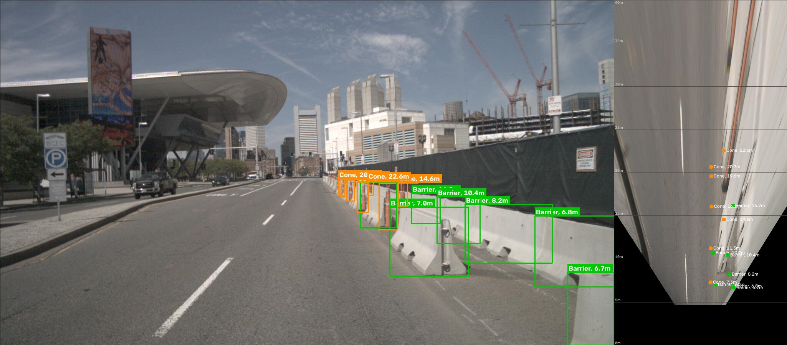
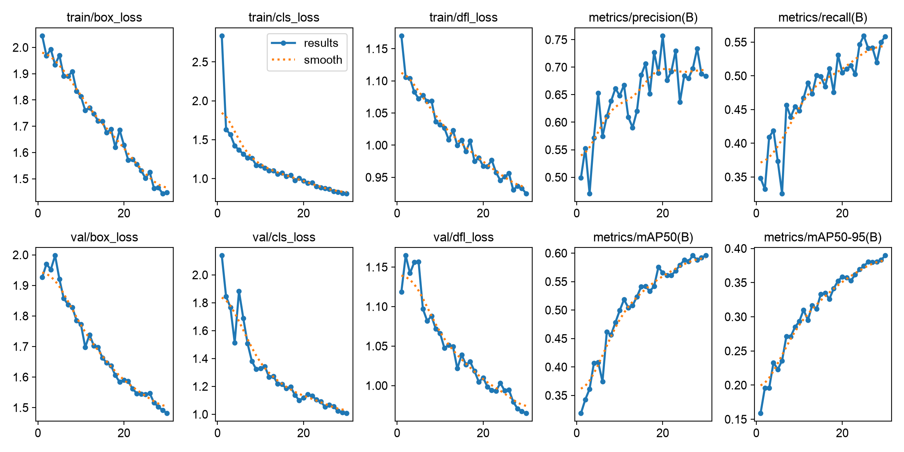
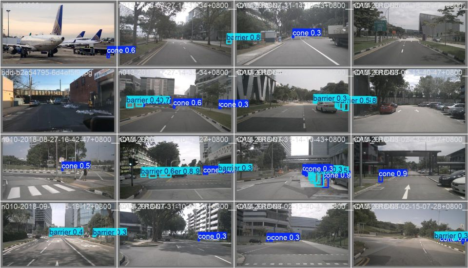
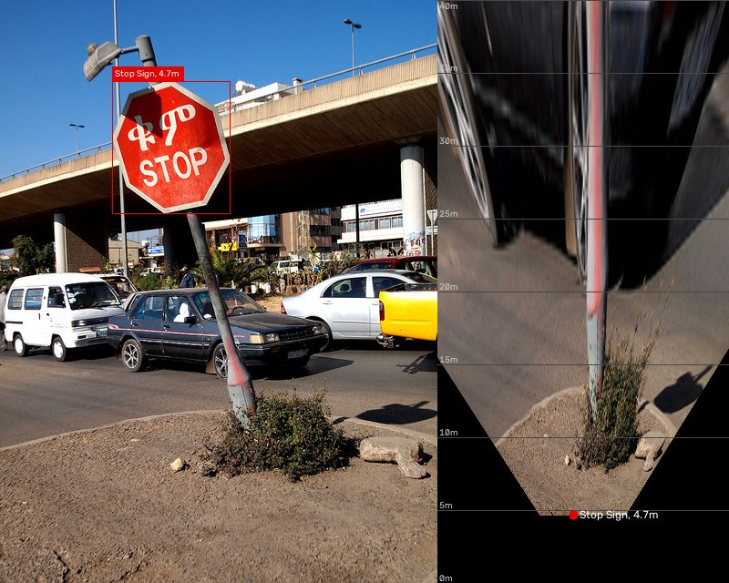
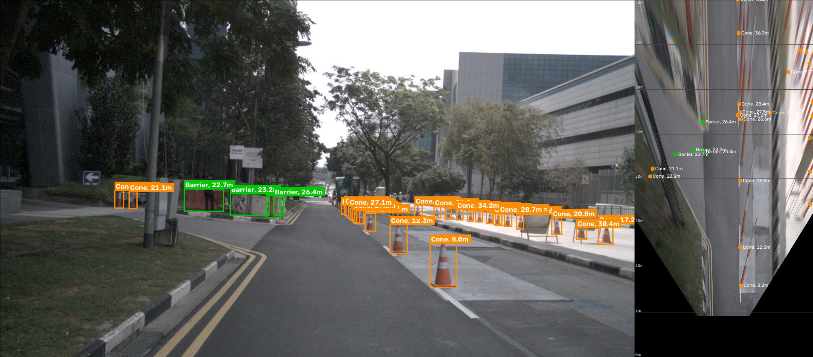
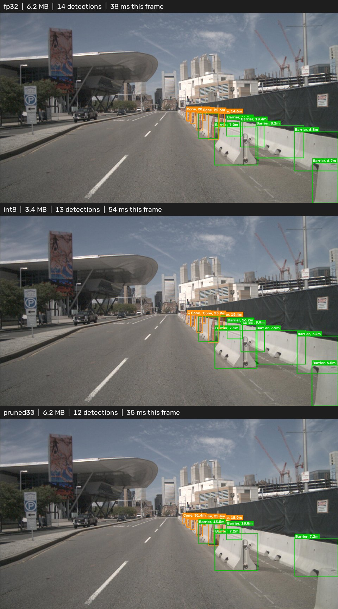
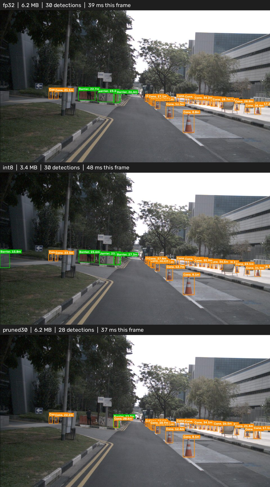
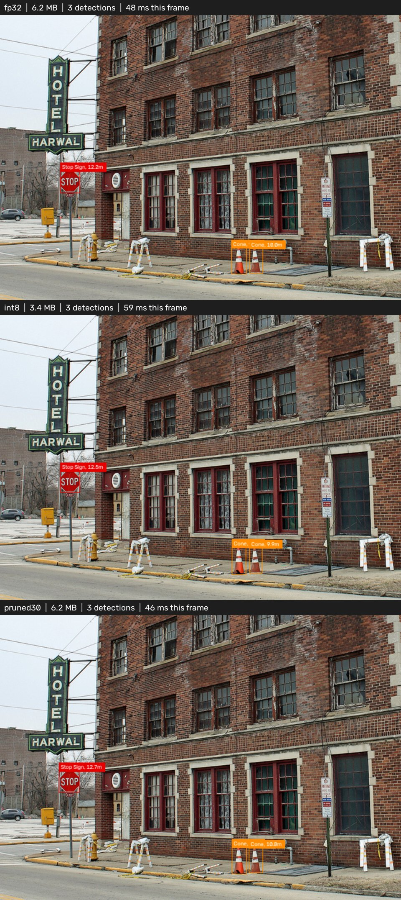
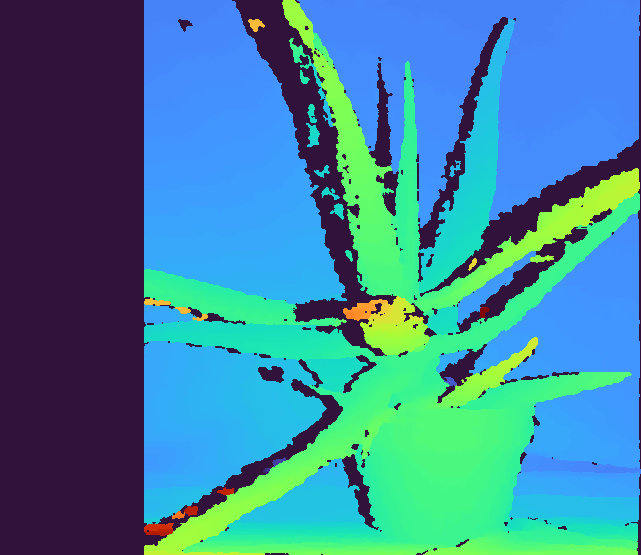
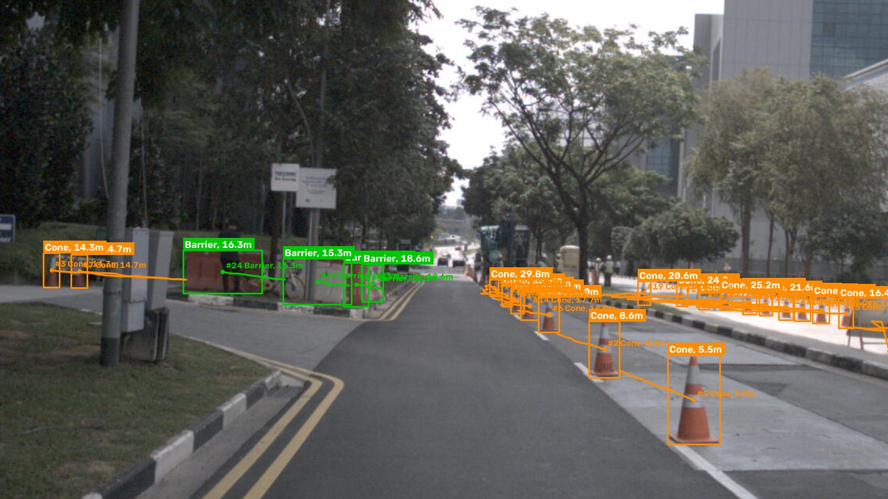

# Object Detection and Distance Estimation for Robot Navigation

**Author: Sharan G S**

A camera-only perception module for a ground robot. It detects **traffic cones, road barriers
and stop signs**, estimates **how far each one is from the camera** with pinhole geometry,
annotates every frame as `Cone, 1.5m`, and measures what **INT8 quantisation, FP16, pruning and
a lighter backbone** do to accuracy and frame rate on CPU and GPU. The optional parts of the
assignment (epipolar geometry and stereo depth, bird's-eye-view homography, optical flow
tracking) are implemented, tested and demonstrated.

The target platform is a robot carrying a **Stereolabs ZED 2i** or an **Intel RealSense D455 /
D435i** on an **NVIDIA Jetson AGX Orin 64 GB**. Camera presets for all three are built in, exact
intrinsics from the camera SDK can be passed on the command line, and the export path to TensorRT
on the Orin is documented. All numbers in this README were measured on the development laptop
(Apple M1, 8 GB, macOS 26) because the Orin was not at hand; the same commands run unchanged on
the Jetson with `--device 0`.

<p align="center">
  
  <br><em>Barriers and cones with estimated distances, and the bird's-eye view built from the camera's ground-plane homography (right panel, forward is up, 5 m grid).</em>
</p>

## Assignment checklist

| Requirement | Where it is done | Evidence |
|---|---|---|
| Detect cones, barriers, stop signs | `train.py`, `detect.py`; YOLOv8n transfer-learned from COCO | [section 1](#1-object-detection), [results/metrics-yolov8n.json](results/metrics-yolov8n.json) |
| Work with BDD100K (plus other datasets) | `data.py`: BDD100K backgrounds, nuImages (cones, barriers), LVIS (stop signs, cones) | [section 1.2](#12-data-bdd100k-plus-two-labelled-sources), [results/bdd100k-labels.json](results/bdd100k-labels.json) |
| Transfer learning, clean modular code | one module per concern, 45 real tests, `navdet` CLI | [layout](#repository-layout) |
| Distance from geometry (focal length, pixel size) | `geometry.py`: $Z = f_y H / h_{\text{box}}$ and the ground-plane method | [section 2](#2-distance-estimation), [worked table](#25-worked-examples-from-pixels-to-metres) |
| Annotate as `Cone, 1.5m` | `detect.py annotate()` | every image in [results/detections/](results/detections/) |
| Quantisation, before vs after | ONNX INT8 static, calibrated | [table](#32-before-and-after) and [figures](#33-before-and-after-on-the-same-frames) |
| Pruning, before vs after | L1 unstructured 30 percent, sparse fine-tune | same table and figures |
| Lightweight backbone swap | YOLOv8n vs s vs m, plus YOLO11n and YOLO26n | same table, [section 3.4](#34-yolo11-and-yolo26-for-edge-devices) |
| FPS on CPU and GPU | end-to-end benchmark harness, `navdet optimize` | same table |
| Epipolar geometry, disparity to depth | `extras/stereo.py` | [section 4.1](#41-epipolar-geometry-and-stereo-depth), [docs/geometry.md](docs/geometry.md) |
| Homography / bird's-eye view | `extras/bev.py` | [section 4.2](#42-homography-and-birds-eye-view) |
| Optical flow tracking | `extras/flow.py` | [section 4.3](#43-optical-flow-tracking) |

## Contents

1. [Results at a glance](#results-at-a-glance)
2. [Repository layout](#repository-layout)
3. [Setup and exact versions](#setup-and-exact-versions)
4. [Object detection](#1-object-detection)
5. [Distance estimation](#2-distance-estimation)
6. [Optimisation for edge devices](#3-optimisation-for-edge-devices)
7. [Extras: epipolar geometry, bird's-eye view, optical flow](#4-extras)
8. [Cameras: ZED 2i, RealSense D455 and D435i](#5-cameras-zed-2i-realsense-d455-and-d435i)
9. [Deployment on Jetson AGX Orin](#6-deployment-on-jetson-agx-orin)
10. [Reproduce everything](#reproduce-everything)
11. [Design decisions and limitations](#design-decisions-and-limitations)
12. [Contact](#contact)

## Results at a glance

| Item | Result |
|---|---|
| Detector | YOLOv8n, COCO-pretrained, fine-tuned 30 epochs at 640 px on 954 images |
| Validation mAP50 / mAP50-95 (180 images, 1078 boxes) | **0.596 / 0.392** |
| Per-class AP50 (cone / barrier / stop sign) | 0.631 / 0.491 / 0.666 |
| Distance method | height prior, $Z = f_y H / h$, plus ground-plane alternative |
| CPU frame rate (M1, 640 px, end to end) | PyTorch FP32 30.7 FPS; ONNX INT8 28.4 FPS at 3.4 MB (mAP50 0.575) |
| GPU frame rate (M1 MPS) | FP32 79.9 FPS, FP16 69.5 FPS, same mAP |
| Pruning 30 percent (L1, no retrain) | mAP50 0.571, checkpoint 17 percent smaller gzipped, FPS unchanged |
| Backbone swap (CPU FPS, YOLOv8 n / s / m) | 26.9 / 15.4 / 9.0; YOLO11n and YOLO26n in [section 3.4](#34-yolo11-and-yolo26-for-edge-devices) |
| Tests | 45 real tests, `uv run pytest`, about 30 seconds |

## Repository layout

```
robot-nav-detection/
  src/navdet/
    classes.py         target classes, display names, real-world heights
    geometry.py        pinhole model: intrinsics, height- and ground-based distance, lateral offset, bearing
    cameras.py         intrinsics presets: nuImages, BDD100K, ZED 2i, RealSense D455, RealSense D435i
    data.py            builds the YOLO dataset from nuImages, LVIS and BDD100K
    train.py           transfer learning with Ultralytics YOLO, mAP evaluation
    detect.py          Detector wrapper (.pt / .onnx / .engine), distance attachment, annotation, JSON
    optimize.py        ONNX export, INT8 static quantisation, FP16, L1 pruning, FPS and mAP benchmark
    extras/stereo.py   fundamental matrix, epipolar lines, disparity to depth, SGBM disparity map
    extras/bev.py      ground-plane homography, bird's-eye-view warp, detections on the metric grid
    extras/flow.py     Lucas-Kanade flow tracker that carries detections across frames
    cli.py             `navdet` command line (prepare-data, train, evaluate, detect, optimize, bev, stereo, flow, bdd-stats)
  tests/               45 tests that exercise the real code paths, no mocks
  docs/geometry.md     derivations: pinhole distance, epipolar geometry, disparity-depth, homography
  docs/optimization.md before/after discussion of every edge optimisation
  results/             metrics, benchmark tables, annotated images, training curves (committed)
  data/demo/           the sample frames used for the figures (committed)
  pyproject.toml, uv.lock, requirements.txt   exact, reproducible environment
```

`data/raw`, `data/yolo`, `runs/`, `*.pt` and `*.onnx` are ignored by git; `navdet prepare-data`
and `navdet train` rebuild them (about 10 minutes of downloads and 52 minutes of training on the
M1 GPU).

## Setup and exact versions

```bash
cd robot-nav-detection
uv sync --all-groups          # creates .venv from uv.lock (exact versions below)
uv run pytest                 # 45 tests
# or, without uv:
python3.12 -m venv .venv && source .venv/bin/activate
pip install -r requirements.txt && pip install -e .
```

| Component | Version | Role |
|---|---|---|
| Python | 3.12.15 | runtime (`requires-python >=3.12,<3.13`) |
| uv | 0.9.30 | environment and lock file |
| PyTorch | 2.15.0 | training, PyTorch inference (CPU, MPS, CUDA) |
| torchvision | 0.29.2 | pretrained ops used by Ultralytics |
| Ultralytics | 8.4.215 | YOLOv8 model, trainer, exporter, validator |
| ONNX | 1.23.2 | exported graph format |
| onnxslim | 0.1.99 | graph simplification during export |
| ONNX Runtime | 1.32.0 | FP32 and INT8 CPU inference |
| OpenCV (opencv-python) | 5.1.0.95 | image I/O, drawing, SGBM stereo, homography, Lucas-Kanade flow |
| NumPy | 2.5.5 | arrays |
| pyarrow | 26.0.1 | reads the nuImages parquet shard |
| Pillow | 13.0.0 | image headers when indexing the sources |
| PyYAML | 6.0.3 | dataset yaml |
| pytest | 8.x, ruff 0.6+ | tests and lint (dev group) |

Hardware used for every number here: Apple M1 (8 cores, 8 GB unified memory), macOS 26. "GPU"
means the M1's Metal Performance Shaders (MPS) backend through PyTorch; "CPU" means the 8 M1
cores, with ONNX Runtime's default CPU execution provider for the ONNX rows.

## 1. Object detection

### 1.1 Concept: transfer learning with a one-stage detector

A one-stage detector such as YOLOv8 runs a convolutional **backbone** (CSPDarknet-style blocks
that turn the image into feature maps at strides 8, 16 and 32), a **neck** (PAN-FPN that mixes
the three scales so small and large objects both get strong features) and a **head** that
predicts, at every feature-map cell, a class score per class and a box (as a distribution over
the distances to the four box edges, the "DFL" loss). Non-maximum suppression removes duplicate
boxes at the end.

Training a detector from scratch needs hundreds of thousands of boxes. **Transfer learning**
reuses the backbone and neck that Ultralytics trained on COCO (80 classes, 118k images), swaps
the classification layer of the head for a new one with our 3 classes, and fine-tunes *all*
layers with a small learning rate on our data. COCO already contains `stop sign`, so that class
transfers almost for free; cones and barriers are new, but the low-level features (edges,
colours, stripes) transfer. The backbone is not frozen: the model is small (3.2 M parameters)
and the domain (a car-mounted camera) differs from COCO's internet photos, so letting the whole
network adapt gives better accuracy than freezing, at no extra training cost that matters here.

### 1.2 Data: BDD100K plus two labelled sources

BDD100K was the suggested starting point and its labels were inspected first. `navdet bdd-stats`
counts the 10,000-image validation split ([results/bdd100k-labels.json](results/bdd100k-labels.json)):

| BDD100K label | boxes |
|---|---|
| car | 102,837 |
| traffic sign | 34,724 |
| traffic light | 26,884 |
| pedestrian | 13,425 |
| truck / bus / bicycle / rider / motorcycle / other | 8,163 |

BDD100K has **no cone, barrier or stop sign class** (stop signs are inside the generic `traffic
sign` label). So the training set is assembled from three public sources, with BDD100K
providing driving-scene **background images** (frames with no target object, which teach the
model what not to fire on, a standard trick for reducing false positives):

| Source | What it contributes | Labels used |
|---|---|---|
| [nuImages front camera](https://huggingface.co/datasets/mviola/nuImages-cam-front) (Motional, CC BY-NC-SA 4.0) | 1,368 real driving frames at 1600 x 900 from a calibrated camera | `movable_object.trafficcone`, `movable_object.barrier` |
| [LVIS v1 val](https://www.lvisdataset.org/) (COCO images, CC BY 4.0) | stop signs and cones in varied scenes | `stop_sign`, `cone` |
| [BDD100K val](https://huggingface.co/datasets/dgural/bdd100k) (BSD) | dashcam backgrounds, 1280 x 720 | none (negatives) |

`navdet prepare-data` (`data.py`) downloads the three sources (about 600 MB), keeps images that
contain a target class, drops boxes under 8 px tall, splits 85/15 deterministically by a hash of
the image id, converts COCO `[x, y, w, h]` boxes to YOLO's normalised `class cx cy w h` lines and
writes `data/yolo/dataset.yaml`. The split it built:

| Split | nuImages | LVIS | BDD100K (background) | images | cone boxes | barrier boxes | stop sign boxes |
|---|---|---|---|---|---|---|---|
| train | 591 | 278 | 85 | 954 | 2,863 | 2,470 | 178 |
| val | 109 | 56 | 15 | 180 | 542 | 501 | 35 |

Cones dominate because a construction zone has dozens per frame; the median labelled box in
the nuImages frames is only 36 px tall at 1600 x 900 (14 px after resizing to 640), which is
what makes this task hard.

### 1.3 Training recipe and results

`navdet train` (`train.py`) runs Ultralytics with: `yolov8n.pt` initial weights, 30 epochs,
640 px, batch 16, the Ultralytics `optimizer=auto` choice (AdamW, lr 0.00143, momentum 0.9,
weight decay 0.0005, 3 warm-up epochs, linear decay), the default augmentation (mosaic, HSV
jitter, translation 0.1, scale 0.5, horizontal flip 0.5), early-stopping patience 15, seed 0. Training took 52 minutes on the M1 GPU. Evaluation
uses `navdet evaluate`, which reports COCO-style mAP: a prediction counts as correct when its
IoU with a ground-truth box of the same class is above 0.5 (mAP50) or above each of 0.50, 0.55,
... 0.95 averaged (mAP50-95).

| Model | Precision | Recall | mAP50 | mAP50-95 | AP50 cone | AP50 barrier | AP50 stop sign | AP50-95 cone / barrier / stop sign |
|---|---|---|---|---|---|---|---|---|
| YOLOv8n fine-tuned (best = epoch 30) | 0.681 | 0.558 | **0.596** | **0.392** | 0.631 | 0.491 | 0.666 | 0.311 / 0.263 / 0.603 |

Full numbers: [results/metrics-yolov8n.json](results/metrics-yolov8n.json). Training curves and
the normalised confusion matrix: [results/training/results.png](results/training/results.png),
[results/training/confusion_matrix_normalized.png](results/training/confusion_matrix_normalized.png).

<p align="center">
  
</p>

Reading the numbers: stop signs are large, distinctive and already known to the COCO weights,
hence the highest AP. Cones are detected well when they are near (the detections in the figures
are all correct) but the many far cones (10 to 20 px) pull recall down. Barriers are the hardest
class because the nuImages label covers very different objects (concrete Jersey walls, plastic
water barriers, metal fences) that are often long, occluded and partly out of frame, so box
localisation is loose and AP50-95 drops. Things that would raise these numbers and are plain to
do with the same code: train at 960 px (`--imgsz 960`, three times the compute), use the nuImages
train split as well (13k frames instead of the 3k validation shard used here to keep the download
small), and more epochs (the curves are still rising at epoch 30).

<p align="center">
  
  <br><em>Predictions on a validation batch (confidence after each label).</em>
</p>

## 2. Distance estimation

### 2.1 Concept: the pinhole camera

A point at depth $Z$ metres, lateral offset $X$ and height $Y$ in the camera frame projects to
pixel $u = f_x X / Z + c_x$, $v = f_y Y / Z + c_y$. The focal lengths $f_x, f_y$ (in pixels) and
the principal point $(c_x, c_y)$ are the **intrinsics**; they are what the SDK of a ZED or
RealSense camera reports, and they scale with the image (halve the resolution, halve all four).
`geometry.py` holds them in `CameraIntrinsics`, with `from_hfov` for a camera known only by its
field of view ($f_x = (W/2) / \tan(\mathrm{HFOV}/2)$) and `scaled` for resizes. Full derivations:
[docs/geometry.md](docs/geometry.md).

### 2.2 Method used: known object height (default)

Similar triangles: an object of real height $H$ at depth $Z$ spans $h = f_y H / Z$ pixels, so

$$Z = \frac{f_y \, H}{h_{\text{box}}}, \qquad X = \frac{(u_{\text{centre}} - c_x)\, Z}{f_x}, \qquad \text{bearing} = \arctan\frac{u_{\text{centre}} - c_x}{f_x}.$$

Assumed heights (`classes.py`): cone 0.70 m (the common 28 inch road cone), barrier 1.00 m
(temporary road barriers are 0.8 to 1.1 m), stop sign 0.75 m (30 inch octagon). This method needs
nothing but the focal length, works for objects that do not touch the ground (a stop sign on a
pole), and its error is easy to reason about: relative depth error = relative height-prior error
+ relative box-height error. A 2 px error on a 20 px box is 10 percent; a real barrier of 0.8 m
assumed as 1.0 m reads 25 percent too far. Distances are rounded to 0.1 m and the detection
confidence is kept next to them.

### 2.3 Alternative: ground-plane intersection (`--method ground`)

For objects standing on flat ground the box bottom is the contact point, so for a camera
$h_c$ metres above the ground and pitched down by $\theta$,

$$Z = \frac{h_c}{\tan\big(\arctan\frac{v_{\text{bottom}} - c_y}{f_y} + \theta\big)}$$

(for a level camera this is $Z = f_y h_c / (v_{\text{bottom}} - c_y)$). It needs no object
sizes, but needs the camera height and pitch, flat ground and an unoccluded bottom edge; it
returns no distance for a bottom edge above the horizon. Both methods are in `geometry.py`
and the detector attaches whichever `DistanceConfig` selects.

### 2.4 Annotated outputs

```bash
uv run navdet detect --weights runs/train/yolov8n/weights/best.pt --source data/demo/images --camera nuimages --bev --device mps
uv run navdet detect --weights runs/train/yolov8n/weights/best.pt --source data/demo/bdd --camera bdd100k --bev --out results/detections-bdd100k
```

Every frame gets `Label, D.Dm` captions ([results/detections/](results/detections/)) and a JSON
record with the box, confidence, distance, lateral offset and bearing
([results/detections/detections.json](results/detections/detections.json)). Examples:

| Frame | Printed detections |
|---|---|
| `lvis-124466` (COCO street) | Stop Sign, 4.7 m (conf 0.93, bearing -8.6 deg) |
| `lvis-190515` | Stop Sign, 14.1 m; Cone, 10.7 m; Cone, 11.5 m |
| `n006-...338762482` (Boston, above) | Barrier 6.7 / 6.8 / 7.0 / 8.2 / 10.4 / 10.7 / 16.2 m; Cone 7.3 / 11.3 / 14.6 / 16.1 / 19.6 / 20.7 / 22.6 m |
| `n003-...039162757` (Singapore cone lane) | 26 cones from 8.0 m to 40 m along the lane, 4 barriers at 23 to 26 m |

<p align="center">
  
  
</p>

Cross-check of the two methods on the Boston frame: the two most confident barriers are
189 px and 185 px tall, so the height prior gives $Z = 1266 \times 1.0 / 189 = 6.7$ m and 6.8 m.
Jersey barriers are 0.81 m rather than the 1.0 m prior, so the corrected values are 5.4 m and
5.5 m. Re-running with `--method ground --camera-height 1.5` gives 4.7 m for the first (its box
is cut by the bottom edge of the frame, so the ground method has no true contact point) and
7.4 m for the second. The spread of about 1 m between methods is the honest size of the error on
this frame: it comes from the barrier-height assumption on one side and from the unknown camera
pitch and the box bottom not being the exact ground contact on the other. On the robot the
stereo depth at the box centre settles it; see section 4.1.

### 2.5 Worked examples: from pixels to metres

The nuImages frames are 1600 x 900 with $f_y$ = 1266.4 px (published calibration), so every
distance in the figures is reproducible by hand from the box height in
[detections.json](results/detections/detections.json):

| Frame | Object (confidence) | Box height $h$ (px) | Assumed height $H$ (m) | $Z = f_y H / h$ | Bearing |
|---|---|---|---|---|---|
| Boston barriers | barrier (0.94) | 184.9 | 1.00 | 1266.4 x 1.00 / 184.9 = **6.8 m** | +28.2 deg |
| Boston barriers | barrier (0.92) | 180.1 | 1.00 | 1266.4 x 1.00 / 180.1 = **7.0 m** | +13.4 deg |
| Boston barriers | barrier (0.84) | 189.6 | 1.00 | 1266.4 x 1.00 / 189.6 = **6.7 m** | +29.7 deg |
| Cone lane | cone (0.87) | 110.4 | 0.70 | 1266.4 x 0.70 / 110.4 = **8.0 m** | +13.4 deg |
| Cone lane | cone (0.86) | 72.0 | 0.70 | 1266.4 x 0.70 / 72.0 = **12.3 m** | +8.4 deg |
| Cone lane | cone (0.79) | 43.7 | 0.70 | 1266.4 x 0.70 / 43.7 = **20.3 m** | -22.2 deg |

The pixel size enters through $f_y$: a 1266 px focal length means each pixel subtends
$1/1266$ rad, so an object $h$ px tall subtends $h/1266$ rad and sits at $H / (h/1266)$
metres, which is the same formula. For the LVIS / COCO frames (stop signs) no calibration
exists, so the preset scaled to the frame is used and the distances there are indicative; on
the robot the ZED or RealSense intrinsics replace the preset exactly (section 5).

## 3. Optimisation for edge devices

### 3.1 Concepts

- **ONNX export.** The PyTorch graph is traced into an ONNX file (static 1x3x640x640 input,
  simplified with onnxslim). ONNX Runtime executes it with fused kernels and no Python overhead
  per layer, which already helps on CPU.
- **INT8 static quantisation.** Weights and activations are stored as 8-bit integers with a
  per-tensor (activations) or per-channel (weights) scale. "Static" means the activation ranges
  are measured once on calibration images (here, training images) instead of at run time;
  Ultralytics writes the Quantize/DeQuantize (QDQ) nodes and ONNX Runtime runs the integer
  kernels. Four times smaller weights, integer arithmetic, and a small accuracy cost that the
  table measures.
- **FP16.** Half-precision floats on the GPU: half the memory traffic and, on tensor cores
  (Jetson Orin, any recent NVIDIA GPU), much higher throughput; on the M1 the gain is modest.
- **Pruning.** `torch.nn.utils.prune.l1_unstructured` zeroes the 30 percent of weights with the
  smallest magnitude in every learned convolution (the fixed DFL decoder convolution is left
  alone), then a fine-tune that re-applies the sparsity mask after every optimiser step tries to
  recover accuracy. Unstructured sparsity shrinks the *stored* model (zeros compress) and is
  what sparse accelerators exploit, but dense CPU/GPU kernels still multiply the zeros, so FPS
  does not change; the table shows this honestly. Structured (channel) pruning would also cut
  FLOPs and is the next step.
- **Lighter backbone.** The same detector family at different widths and depths: YOLOv8n
  (3.2 M parameters, 8.7 GFLOPs), YOLOv8s (11.2 M, 28.6 GFLOPs), YOLOv8m (25.9 M, 78.9 GFLOPs).
  The fine-tuned model is the n; the s and m rows in the table are timed with their COCO weights
  to show the speed side of a backbone swap on identical frames. Newer families (YOLO11,
  YOLO26) are covered in [section 3.4](#34-yolo11-and-yolo26-for-edge-devices).

`navdet optimize` (`optimize.py`) exports and measures each variant **end to end** (letterbox
preprocessing, inference, NMS postprocessing) on real validation frames, 40 timed frames after
warm-up, then re-runs mAP on the validation split so each speed number has an accuracy number
beside it.

### 3.2 Before and after

| Variant | Device | Precision | Size (MB) | mAP50 | mAP50-95 | Latency (ms) | FPS |
|---|---|---|---|---|---|---|---|
| pytorch fp32 | cpu | fp32 | 6.2 | 0.596 | 0.392 | 32.5 | 30.7 |
| onnx fp32 | cpu | fp32 | 12.2 | 0.592 | 0.389 | 47.2 | 21.2 |
| onnx int8 (static, calibrated) | cpu | int8 | 3.4 | 0.575 | 0.364 | 35.2 | 28.4 |
| pytorch fp32 | mps | fp32 | 6.2 | 0.596 | 0.392 | 12.5 | 79.9 |
| pytorch fp16 | mps | fp16 | 6.2 | 0.596 | 0.392 | 14.4 | 69.5 |
| pruned 30% (L1, no finetune) | cpu | fp32 | 6.2 | 0.571 | 0.360 | 31.9 | 31.4 |
| pruned 30% + 2 ep sparse finetune | cpu | fp32 | 6.2 | 0.547 | 0.352 | 30.6 | 32.7 |
| backbone yolov8n (COCO weights, speed only) | cpu | fp32 | 6.2 | n/a | n/a | 37.1 | 26.9 |
| backbone yolov8n (COCO weights, speed only) | mps | fp32 | 6.2 | n/a | n/a | 20.5 | 48.7 |
| backbone yolov8s (COCO weights, speed only) | cpu | fp32 | 21.5 | n/a | n/a | 64.9 | 15.4 |
| backbone yolov8s (COCO weights, speed only) | mps | fp32 | 21.5 | n/a | n/a | 25.0 | 40.0 |
| backbone yolov8m (COCO weights, speed only) | cpu | fp32 | 49.7 | n/a | n/a | 111.1 | 9.0 |
| backbone yolov8m (COCO weights, speed only) | mps | fp32 | 49.7 | n/a | n/a | 47.8 | 20.9 |
| backbone yolo11n (COCO weights, speed only) | cpu | fp32 | 5.3 | n/a | n/a | 35.8 | 28.0 |
| backbone yolo11n (COCO weights, speed only) | mps | fp32 | 5.3 | n/a | n/a | 25.7 | 38.9 |
| backbone yolo26n (COCO weights, speed only) | cpu | fp32 | 5.3 | n/a | n/a | 37.9 | 26.4 |
| backbone yolo26n (COCO weights, speed only) | mps | fp32 | 5.3 | n/a | n/a | 18.3 | 54.7 |

How to read it (full discussion in [docs/optimization.md](docs/optimization.md)):

- **CPU.** PyTorch FP32 gives 30.7 FPS. The INT8 ONNX model is 3.6 times smaller than the
  FP32 ONNX file and 34 percent faster than it, at a cost of 0.021 mAP50. ONNX Runtime's arm64
  CPU kernels are slower than PyTorch's Accelerate path on this laptop, so on the M1 the INT8
  win is size rather than speed; on x86 or with TensorRT the ordering is the usual one.
- **GPU (MPS).** FP32 reaches 79.9 FPS, 2.6 times the CPU, at identical mAP. FP16 is not faster
  on the M1 (69.5 FPS); the gain belongs to CUDA tensor cores, which the Jetson has.
- **Pruning.** 30 percent L1 sparsity costs 0.025 mAP50 with no retraining, compresses the
  checkpoint by 17 percent, and leaves FPS unchanged because dense kernels still multiply the
  zeros. The 2-epoch sparse fine-tune did not recover accuracy (0.547); a longer, lower-lr
  recovery is the known fix. The first version of this step pruned the fixed DFL decoder
  convolution too and collapsed mAP to 0.001; the test suite now guards against that.
- **Backbone.** YOLOv8n is 1.75 times faster than YOLOv8s and 3 times faster than YOLOv8m on the
  CPU, and 3.5 and 8 times smaller; the fine-tuned model is the n.

Raw numbers: [results/optimization/optimization.json](results/optimization/optimization.json).
Discussion: [docs/optimization.md](docs/optimization.md).

### 3.3 Before and after on the same frames

`navdet compare` runs one frame through several model files and stacks the annotated results
with the file size, detection count and that frame's latency in each header, so the effect of
quantisation and pruning is visible on the actual detections and distances, not only in the
table. Top: FP32 PyTorch (before). Middle: INT8 ONNX (after quantisation). Bottom: 30 percent
L1 pruned (after pruning, no retraining).

```bash
uv run navdet compare --models fp32=runs/train/yolov8n/weights/best.pt int8=results/optimization/best-int8.onnx pruned30=results/optimization/best-pruned30.pt --image data/demo/images/<frame>.jpg --camera nuimages
```

<p align="center">
  
  <br><em>Boston barriers: FP32 finds 14 objects, INT8 13 (distances within 0.4 m of FP32 on every shared object), the pruned model 12 and it misses the nearest barrier, which matches its lower mAP.</em>
</p>

<p align="center">
  
  <br><em>Cone lane: the far cones (10 to 20 px) are where INT8 and pruning lose detections first.</em>
</p>

<p align="center">
  
  <br><em>Stop sign (COCO frame, 60 degree field of view assumed): all three variants keep the sign and both cones.</em>
</p>

Single-frame latencies in the headers are one sample each; the averaged numbers over 40 frames
are the ones in the table above.

### 3.4 YOLO11 and YOLO26 for edge devices

The pipeline is not tied to YOLOv8. Ultralytics 8.4 ships **YOLO11** (the 2024 successor, about
the same speed as v8 at higher mAP on COCO: YOLO11n 2.6 M parameters, 6.5 GFLOPs) and
**YOLO26** (2025/2026, trained end to end without NMS, so the exported model has no
non-maximum-suppression stage at all, which removes the 6 ms of post-processing this pipeline
pays per frame on CPU and makes TensorRT INT8 engines simpler and more deterministic on a
Jetson). Both load through the same `Detector` and train with the same command:

```bash
uv run navdet train --model yolo11n.pt --name yolo11n       # YOLO11 nano
uv run navdet train --model yolo26n.pt --name yolo26n       # YOLO26 nano, NMS-free
uv run navdet optimize --weights runs/train/yolo26n/weights/best.pt
```

Measured on the same validation frames with their COCO weights (speed only, same harness):

| Model (COCO weights) | File (MB) | CPU FPS | CPU latency (ms) | GPU (MPS) FPS | GPU latency (ms) | Post-processing |
|---|---|---|---|---|---|---|
| YOLOv8n | 6.2 | 26.9 | 37.1 | 48.7 | 20.5 | NMS |
| YOLO11n | 5.3 | 28.0 | 35.8 | 38.9 | 25.7 | NMS |
| YOLO26n | 5.3 | 26.4 | 37.9 | **54.7** | **18.3** | none (end to end) |

YOLO26n is the fastest of the three on the GPU because it has no NMS stage; on this CPU the
three nano models are within 10 percent of each other, and the 80-class NMS of the COCO weights
is the same cost for v8 and 11.

For the Orin the recommendation is YOLO26n or YOLO11n exported to TensorRT INT8; YOLOv8n was
fine-tuned here because its export and quantisation paths are the most battle-tested, and the
accuracy comparison between the three families on this dataset is one `navdet train` per model.

## 4. Extras

### 4.1 Epipolar geometry and stereo depth

Two cameras related by rotation $R$ and translation $t$ satisfy $x_r^\top F x_l = 0$ for every
matching pixel pair, with the fundamental matrix $F = K_r^{-\top}[t]_\times R K_l^{-1}$. The
line $F x_l$ is the epipolar line in the right image; the match must lie on it, so matching is a
1D search. For a rectified pair with focal length $f$ and baseline $B$ the two projections of a
point at depth $Z$ differ by the **disparity** $d = u_l - u_r = fB / Z$, so

$$Z = \frac{f B}{d}, \qquad \Delta Z = \frac{Z^2}{f B}\,\Delta d .$$

`extras/stereo.py` implements `fundamental_matrix`, `epipolar_line`, `depth_from_disparity`,
an SGBM `disparity_map` and `depth_map`; the tests check that a horizontal rig gives horizontal
epipolar lines and that SGBM recovers a known 8 px shift. `navdet stereo` runs it on a rectified
pair; on the Middlebury Aloe pair (published $f$ = 3740 px, $B$ = 160 mm, matched at half size):

<p align="center">
  
  <br><em>SGBM disparity on the Aloe pair; the plant is nearer than the wall. Absolute depth on this pair also needs the crop offset (dmin) that Middlebury publishes separately, which the <code>--disparity-offset</code> option takes.</em>
</p>

What this means for the robot cameras: with the ZED 2i ($f \approx 448$ px at 720p and the 110
degree lens, $B$ = 120 mm) a one-pixel disparity error is 0.17 m at 3 m and 1.9 m at 10 m; with
the D435i ($f \approx 931$ px, $B$ = 50 mm) it is 0.19 m at 3 m and 2.1 m at 10 m. Both cameras
therefore give reliable stereo depth only in the first few metres, which is why the monocular
height prior is kept for far objects and the stereo depth, where available, should replace it
near the robot.

### 4.2 Homography and bird's-eye view

Ground points sit on one plane, so the ground and the image are related by a homography. With the
world origin on the ground below the camera (X right, Z forward), a ground point $(X, Z)$ is
$(X, h_c, Z)$ in a level camera frame; pitching the camera down by $\theta$ gives

$$\lambda\,(u, v, 1)^\top = K R_x(\theta)\,(X, h_c, Z)^\top = K\,[\,r_1 \mid r_3 \mid h_c r_2\,]\,(X, Z, 1)^\top = H\,(X, Z, 1)^\top .$$

`extras/bev.py` builds $H$, composes it with the metric grid of the output image and calls
`cv2.warpPerspective` with the inverse map, which produces the panel on the right of the figures
(forward up, 5 m grid lines). Objects above the ground smear along their viewing ray in such a
warp, as expected, so the detections are plotted from their estimated $(X, Z)$ rather than warped
as pixels. `bev_from_points` is the four-point variant for a camera with no calibration. The tests
check the projection against the pinhole model, the horizon position for a pitched camera, and
that a mark drawn at a known ground position lands in the right cell of the warp.

### 4.3 Optical flow tracking

`extras/flow.py` tracks the centroid of every detection with pyramidal **Lucas-Kanade** optical
flow (`cv2.calcOpticalFlowPyrLK`, 21 px window, 3 pyramid levels), then matches new detections to
the predicted positions by label and distance. A track survives a few missed detections, so the
detector can run every $n$-th frame while flow fills the gaps, which is how a small CPU meets a
frame-rate budget. `navdet flow` runs on a video, or synthesises an approach sequence (progressive
zoom towards the vanishing point) from one frame when no video is at hand:

```bash
uv run navdet flow --weights runs/train/yolov8n/weights/best.pt --image data/demo/images/n003-2018-09-13-11-22-44+0800__CAM_FRONT__1536809039162757.jpg --frames 30 --detect-every 5
```

<p align="center">
  
  <br><em>Frame 15 of 30: numbered tracks with their trails; the detector ran on frames 0, 5, 10 and 15, flow carried the tracks in between. Video: <a href="results/flow/tracks.mp4">results/flow/tracks.mp4</a>, per-frame positions: <a href="results/flow/tracks.json">results/flow/tracks.json</a>.</em>
</p>

## 5. Cameras: ZED 2i, RealSense D455 and D435i

`cameras.py` carries a preset per camera from the datasheet field of view, which is good enough
to start; the exact calibrated intrinsics should be read from the SDK and passed as
`--fx --fy --cx --cy`, which override the preset. Each preset also stores the stereo baseline
used by the epipolar section and a default mounting height for `--method ground`.

| Preset | RGB field of view (H x V) | $f_x$ at 1280 x 720 | Stereo baseline | Notes |
|---|---|---|---|---|
| `zed2i` | 110 x 70 deg (2.1 mm lens) | 448 px | 120 mm | ZED SDK gives exact values: `zed.get_camera_information().camera_configuration.calibration_parameters.left_cam` (`fx, fy, cx, cy`) |
| `d455` | 90 x 65 deg | 640 px | 95 mm | `pyrealsense2`: `profile.get_stream(rs.stream.color).as_video_stream_profile().get_intrinsics()` |
| `d435i` | 69 x 42 deg | 931 px | 50 mm | same call as the D455 |
| `nuimages` | 64.5 deg (f = 1266 px at 1600 x 900) | 1013 px | none | published nuScenes front camera calibration, used for training frames |
| `bdd100k` | 65 deg assumed | 640 px | none | dashcams without published calibration |

```bash
# exact intrinsics from the SDK, 1280 x 720 colour stream of a D455 mounted 0.45 m above the ground
uv run navdet detect --weights best.pt --source frames/ --fx 642.1 --fy 641.7 --cx 639.4 --cy 362.0 --camera-height 0.45 --method height
```

The RGB intrinsics are the right ones to use because the detector runs on the colour image; the
depth stream of a RealSense or the ZED's depth map can replace the geometric estimate inside
`with_distances` by sampling the depth image at the box centre, which is the natural next step on
the robot.

## 6. Deployment on Jetson AGX Orin

Everything in this repository is CUDA-ready through PyTorch and Ultralytics; the Orin adds
TensorRT, which is the fastest path there.

```bash
# on the Orin (JetPack 6, PyTorch wheel from NVIDIA, tensorrt from JetPack)
pip install -r requirements.txt && pip install -e .
uv run navdet train --device 0 --batch 32                              # trains in a few minutes per epoch
uv run navdet optimize --weights runs/train/yolov8n/weights/best.pt    # CUDA FP32/FP16 rows plus the CPU rows
yolo export model=runs/train/yolov8n/weights/best.pt format=engine quantize=16              # TensorRT FP16 engine
yolo export model=runs/train/yolov8n/weights/best.pt format=engine quantize=8 data=data/yolo/dataset.yaml   # TensorRT INT8 with calibration
uv run navdet detect --weights runs/train/yolov8n/weights/best.engine --source /dev/video0 --camera zed2i --device 0
```

`Detector` loads `.pt`, `.onnx` and `.engine` files through the same Ultralytics backend, so the
distance, annotation and tracking code does not change between the laptop and the Jetson. For the
Orin's 64 GB and 2048 CUDA cores the expected ordering is TensorRT INT8 > TensorRT FP16 > PyTorch
FP16 > PyTorch FP32, with YOLOv8n comfortably above 100 FPS at 640 px; the laptop table below
shows the same ordering for the formats it can run.

## Reproduce everything

```bash
cd robot-nav-detection
uv sync --all-groups
uv run pytest -q                                   # 45 passed
uv run navdet bdd-stats                             # BDD100K label counts -> results/bdd100k-labels.json
uv run navdet prepare-data                          # downloads nuImages/LVIS/BDD100K pieces -> data/yolo (about 10 min)
uv run navdet train --device mps                    # or --device 0 (CUDA) / cpu; 30 epochs, 52 min on the M1
uv run navdet evaluate --weights runs/train/yolov8n/weights/best.pt --device mps --out results/metrics-yolov8n.json
uv run navdet detect --weights runs/train/yolov8n/weights/best.pt --source data/demo/images --bev --device mps
uv run navdet optimize --weights runs/train/yolov8n/weights/best.pt --finetune-epochs 2 --runs 40 --backbones yolov8n.pt yolov8s.pt yolov8m.pt
uv run navdet stereo --left data/demo/stereo/aloeL.jpg --right data/demo/stereo/aloeR.jpg --focal 3740 --baseline 0.16 --scale 0.5 --num-disparities 144 --max-depth 3
uv run navdet bev --weights runs/train/yolov8n/weights/best.pt --image data/demo/images/<frame>.jpg
uv run navdet flow --weights runs/train/yolov8n/weights/best.pt --image data/demo/images/<frame>.jpg --frames 30 --detect-every 5
```

## Design decisions and limitations

- **Geometry rather than a depth network for distance.** A monocular depth model needs depth
  labels the sources do not have; the height prior needs one number per class, runs in
  microseconds and has an error model you can write down. The ground-plane method and the stereo
  formula are there for the cases where the prior is wrong (unusual object sizes) or where a
  stereo camera is mounted.
- **Three classes, whole network fine-tuned.** See 1.1. Freezing the backbone would save little
  on a 3 M-parameter model and would hurt on new classes.
- **Benchmarks are end to end** on real frames, because the robot pays for preprocessing and
  NMS too, and because a bare forward pass makes INT8 look better than it is.
- **Real tests only.** Each test calls the code the way the CLI does: parquet and zip files are
  written and parsed, YOLOv8n is really exported to ONNX and pruned, one real training epoch runs
  on `coco8`, and synthetic stereo pairs and frame sequences check the geometry and the tracker
  against known answers.
- **Limitations.** Distances assume the heights in `classes.py`; a low barrier reads too far.
  nuImages frames are downscaled 2.5x for training, which is what limits cone recall; training at
  960 px is a one-flag change. BDD100K dashcams have no published calibration, so the `bdd100k`
  preset is an assumption. The GPU rows come from Apple's MPS backend, not from the Orin;
  TensorRT numbers are to be collected on the robot with the commands in section 6.

## Contact

- **Name:** Sharan G S
- **GitHub:** [Sharan-G-S](https://github.com/Sharan-G-S)
- **Email:** sharangs08@gmail.com
- **Phone:** +91 XXXXX XXXXX
